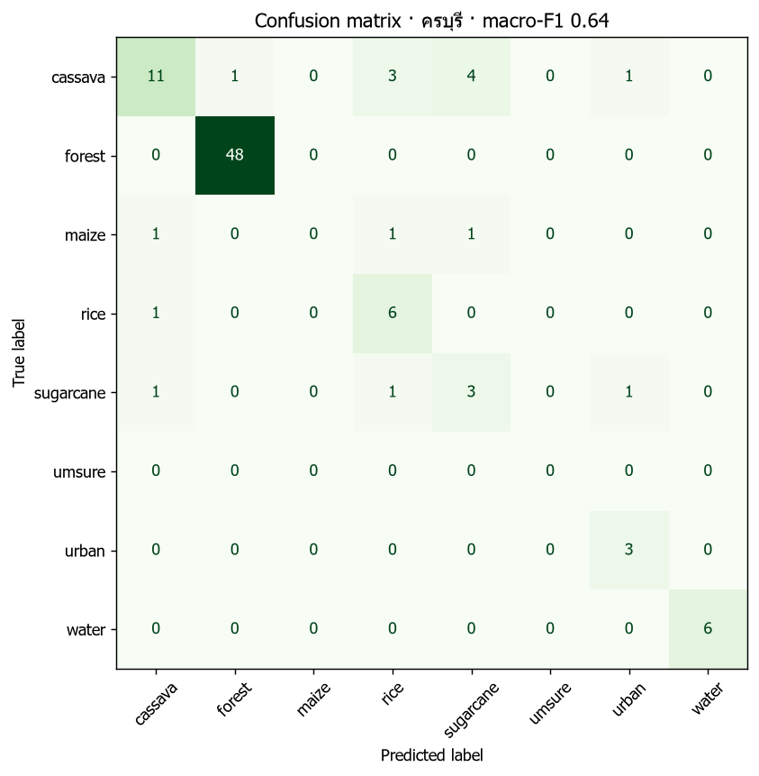
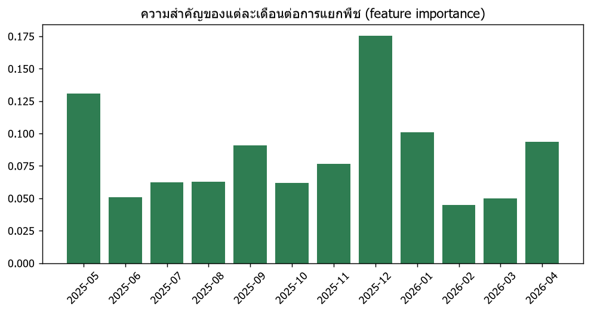

# AI Crop Intelligence

จำแนกชนิดพืชจากอนุกรมเวลา NDVI ของภาพดาวเทียม Sentinel-2 ในจังหวัดนครราชสีมา ด้วยเครื่องมือ open-source ทั้งหมด

- **พื้นที่:** 4 อำเภอ ได้แก่ ด่านขุนทด สีคิ้ว พิมาย (ชุดเทรน) และครบุรี (ชุดทดสอบ แยกพื้นที่กันแบบ spatial split)
- **ภาพ:** Sentinel-2 L2A จาก [Earth Search STAC](https://earth-search.aws.element84.com/v1) ทำ median composite รายเดือน พ.ค. 2025 – เม.ย. 2026 ที่ 20 ม. (EPSG:32647) และตัดเมฆด้วย SCL
- **Label:** จุดตัวอย่าง 400 จุด ทำเองใน QGIS
- **โมเดล:** Random Forest ใช้ NDVI 12 เดือนเป็น feature
- **คลาส:** ข้าว, อ้อย, มันสำปะหลัง, ข้าวโพด, ป่าไม้, แหล่งน้ำ, ชุมชน

## ผลลัพธ์ปัจจุบัน (รอบ 2)

วัดผลบนพื้นที่ครบุรี ซึ่งโมเดลไม่เคยเห็นตอนเทรน:

| ตัวชี้วัด | ค่า |
|---|---|
| Macro-F1 | 0.64 |
| Overall accuracy | 0.83 |

ป่าไม้และแหล่งน้ำจำแนกได้แม่น (F1 ≈ 0.99–1.00) คอขวดอยู่ที่การแยก **มันสำปะหลังกับอ้อย** ซึ่งมีช่วงการเติบโตใกล้กัน ส่วนข้าวโพดมีตัวอย่างน้อยเกินไป เดือนที่โมเดลให้น้ำหนักมากที่สุดคือ ธ.ค. และ พ.ค.

| Confusion matrix | Feature importance |
|---|---|
|  |  |

รายละเอียดเต็มอยู่ใน [output/model/report.txt](output/model/report.txt)

## Pipeline

| ไฟล์ | หน้าที่ | ผลลัพธ์ |
|---|---|---|
| `00_check_offset.py` | ตรวจว่าข้อมูลมี BOA offset หรือไม่ | พิมพ์ค่าใน console |
| `02_s2_ndvi_monthly.py` | ดึง NDVI รายเดือน 12 เดือน (ข้ามเดือนที่มีไฟล์แล้ว) | `output/monthly/ndvi_YYYY-MM.tif` |
| `03_stack_ndvi.py` | รวม 12 เดือนเป็นไฟล์เดียว | `output/ndvi_stack_12m.tif` |
| `04_point_curves.py` | ดึงค่า NDVI ที่จุด label และวาดกราฟ | `output/label_points_ndvi.csv`, `output/curves/` |
| `05_train_rf.py` | เทรน Random Forest วัดผล และทำแผนที่ | `output/model/` |
| `06_web_app.py` + `web/index.html` | เว็บดูผล (FastAPI + MapLibre) | http://127.0.0.1:8000 |

`01_s2_ndvi.py` เป็นตัวทดลองเดือนเดียว เลิกใช้แล้ว

## วิธีรัน

ต้องมี Python 3.12 และใช้ Windows (PowerShell)

```powershell
python -m venv .venv
.venv\Scripts\Activate.ps1
pip install -r requirements.txt

python 02_s2_ndvi_monthly.py   # ใช้เวลานาน ดึงภาพจากอินเทอร์เน็ต
python 03_stack_ndvi.py
python 04_point_curves.py
python 05_train_rf.py
python 06_web_app.py           # เปิด http://127.0.0.1:8000
```

ถ้า PowerShell ไม่ยอมให้ activate ให้รัน `Set-ExecutionPolicy -Scope Process -ExecutionPolicy Bypass` ก่อน

## เว็บดูผล

- แผนที่ชนิดพืชและแผนที่ความมั่นใจของโมเดล ซ้อนบนแผนที่ฐานหรือภาพดาวเทียม
- ซ่อนหรือแสดงทีละคลาสได้
- คลิกพิกเซลเพื่อดูกราฟ NDVI 12 เดือนเทียบกับค่าเฉลี่ยของแต่ละคลาส
- ตารางพื้นที่รายอำเภอ เป็นการนับพิกเซล ยังไม่ได้ปรับตามวิธี Olofsson et al. 2014

## ข้อควรระวัง

- **ใช้ `OFFSET = 0`** ข้อมูล Earth Search ไม่ได้บวก +1000 แม้ metadata จะระบุ offset −0.1
- **ค้นหา STAC ด้วย `bbox`** ไม่ใช่ `intersects` เพราะ polygon อำเภอซับซ้อนจน request ใหญ่เกิน
- **กันข้อมูลรั่วระหว่างชุด** ชุดเทรนขยายแต่ละจุดเป็นหน้าต่าง 3×3 (เก็บเฉพาะพิกเซลที่ RMSE ≤ 0.08 เทียบกับจุดกลาง) ส่วนชุดทดสอบใช้พิกเซลเดียว และอยู่คนละอำเภอ

## งานต่อไป

1. ทำ label ข้าวโพดเพิ่ม หรือรวมเข้ากับคลาส other
2. `07_predict.py` ทำนายพื้นที่หรือปีใหม่
3. ใช้ 6 แบนด์ (B, G, R, NIR, SWIR1, SWIR2) กับ LightGBM และ TempCNN
4. ทดลอง Prithvi-EO-2.0 ผ่าน TerraTorch
5. ประมาณพื้นที่พร้อมช่วงความเชื่อมั่นตามแนว Olofsson et al. 2014
6. หน้าบ้าน Next.js และรวมระบบด้วย Docker Compose

## แหล่งข้อมูล

- ภาพ Sentinel-2: Copernicus / ESA ผ่าน Element 84 Earth Search
- ขอบเขตอำเภอ (`data/aoi.geojson`): ชุดขอบเขตการปกครองของประเทศไทย (COD-AB) จาก OCHA / HDX
- แผนที่ฐานในเว็บ: © OpenStreetMap contributors และ Esri World Imagery
